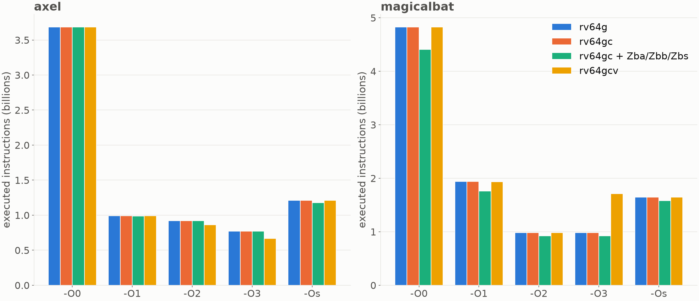
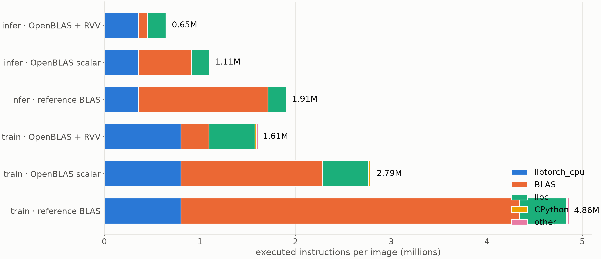
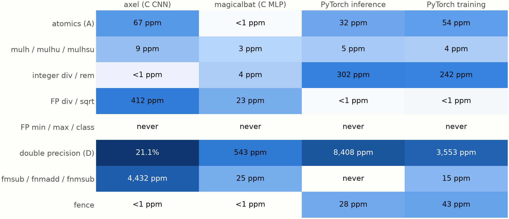

# CNN workload profiling for RISC-V

Which RISC-V instructions do neural-network workloads actually use, and how often?
This repository compiles two small C MNIST networks for RV64 in 80 compiler variants and counts their opcodes **statically** (in the compiled code) and **dynamically** (every executed instruction, under QEMU).
It then does the same, dynamically, for a PyTorch CNN running on real RISC-V CPython + PyTorch.
The results feed an ISA-pruning analysis: which instructions a workload-specific RISC-V core could drop and emulate in software.

| workload | source | model | arithmetic |
|---|---|---|---|
| `axel` | [AxelMontlahuc/CNN](https://github.com/AxelMontlahuc/CNN) (git submodule) | conv 8×3×3 → 2×2 max-pool → dense(10) → softmax | `double` |
| `magicalbat` | [Magicalbat/videos · machine-learning](https://github.com/Magicalbat/videos/tree/ec6752816fef/machine-learning) (vendored, MIT) | 784-16-16-10 MLP with a residual add | `float` |
| PyTorch CNN | `torch_cnn/mnist_cnn.py` (this repo) | conv 1→8 → pool → conv 8→16 → pool → fc(10) | `float`, via BLAS |

## Headline results

All numbers are exact instruction counts, averaged over 5 runs (std ≤ 0.2%). See `results/` for everything.



- **The optimization level dominates.** Going from -O0 to -O3 cuts executed instructions about 5× for both C programs. Within one -O level, `-march` mostly doesn't matter:
  - rv64g and rv64gc execute exactly the same number of instructions; compression only changes code size.
  - Zba/Zbb/Zbs saves about 6% on magicalbat (`sh2add` replaces shift + add in array indexing).
- **Auto-vectorization can backfire.** RVV at -O3 cuts axel by 13%, but makes magicalbat 74% *worse* (0.98B → 1.71B instructions). Its matrix products multiply by 784×1 vectors, so the vectorized loop handles one element per call and pays `vsetvli`, alias checks and vector load/store overhead every time.
- **Arithmetic is the minority.** FP arithmetic is at most about a fifth of executed instructions, often under a tenth; the rest is addressing, data movement and loop control.
- **Static ≠ dynamic.** `fld`/`flw`, `fmadd` and `bne` dominate execution but are rare in the code, while `auipc` and `ld`/`sd` spills are common in the code but rarely run.
- **In PyTorch, the BLAS library sets the cost per image:**

  | | OpenBLAS + RVV | scalar OpenBLAS | reference BLAS |
  |---|---|---|---|
  | inference | 0.65M | 1.11M | 1.91M |
  | training | 1.61M | 2.79M | 4.86M |

  libtorch's own kernels are scalar (about 0.36M instructions per inference image whatever the BLAS); the only vector instructions come from OpenBLAS (`vfmacc.vf`).



### ISA pruning (CARVE-V-style prune + bridge)

We pick instructions to remove by four tests:
1. They rarely execute.
2. Removing them deletes a real hardware unit.
3. Their removal is licensed by a system property (e.g. a single hart).
4. They stay off the time-critical path.

Removed instructions trap and are emulated in software.



| decision | families |
|---|---|
| **Prune** | `fmin`/`fmax`/`fclass` (never executed), atomics (≤ 67 ppm, single hart), `mulh*` (≤ 9 ppm), `fdiv`/`fsqrt` (data loading and weight init, not inference), `div`/`rem` for the C programs (≤ 4 ppm, training shuffle only) |
| **Keep** | `div`/`rem` for PyTorch (240–300 ppm, in tensor indexing on the inference path), D unless the code is float-only, `fmsub`/`fnmadd`/`fnmsub` (shared FMA datapath), `fence`, compressed instructions, F (the models are float) |

The estimated bridge cost of the prune set is under 3% for the C programs, once image loading multiplies by 1/255 instead of dividing. The per-trap cycle penalties behind that estimate are illustrative assumptions (`plot_slides.py`, `PRUNE_GROUPS`).

## Repository layout

```
CNN/AxelMontlahuc/     submodule: upstream axel CNN (+ the MNIST IDX files used by every workload)
CNN/magicalbat/        vendored upstream magicalbat MLP, unmodified, with its MIT LICENSE
patches/               workload-size knobs added to copies of the two C programs
profile_opcodes.py     C pipeline: build 80 variants → static counts → 400 QEMU runs → CSVs
profile_torch.py       PyTorch pipeline: 40 QEMU runs of torch_cnn/mnist_cnn.py → CSVs
plot.py, plot_torch.py detailed plots → results/plots/
plot_slides.py         slide-sized plots, incl. the pruning analysis → results/plots/slides/
torch_cnn/             the PyTorch CNN and its region-of-interest markers (roi.py)
tools/opcount.c        QEMU TCG plugin: exact executed count per (mnemonic, function)
tools/opcount_roi.c    QEMU TCG plugin: counts per shared object, whole run and region of interest
tools/build_qemu.sh    builds qemu-riscv64 10.0.3 with plugin support → third_party/qemu
tools/build_rootfs.sh  riscv64 Debian rootfs with python3 + torch, no root needed → third_party/rv-rootfs
tools/make_mat.py      MNIST IDX → magicalbat's .mat input files (replaces its tensorflow script)
results/               CSVs and plots from the runs in this repo
```

## Setup

Tested on Debian 13 (x86-64).

```sh
git clone --recursive https://github.com/ImtiazKabir/CNN-workload-profiling-for-RISC-V.git
cd CNN-workload-profiling-for-RISC-V
# already cloned without --recursive?  git submodule update --init

sudo apt install gcc-riscv64-linux-gnu g++-riscv64-linux-gnu ninja-build meson \
                 libglib2.0-dev pkg-config python3-venv patch curl
python3 -m venv venv && venv/bin/pip install numpy pandas matplotlib
```

Debian's own `qemu-user` is built without TCG plugin support, so `tools/build_qemu.sh` builds a plugin-enabled `qemu-riscv64` (about 5 minutes, once).

## Running

### C programs: static + dynamic

```sh
tools/build_qemu.sh                     # qemu-riscv64 with plugins → third_party/qemu
make -C tools                           # tools/opcount.so, tools/opcount_roi.so
venv/bin/python profile_opcodes.py      # 80 variants, 400 QEMU runs (~5 min on 8 cores)
venv/bin/python plot.py                 # results/plots/*.png
```

- `profile_opcodes.py --quick --testcases 2` runs a 12-variant smoke test (about 25 s).
- `--program axel` limits the run to one program.
- Finished QEMU runs are cached in `build/variants/<prog>/<variant>/dyn/`.

**Variants.** `{O0,O1,O2,O3,Os} × {rv64g, rv64gc, rv64gc_zba_zbb_zbs, rv64gcv} × {default, -ffast-math}`, all with `-mabi=lp64d`. Debian ships only an lp64d glibc, so soft-float variants can't be linked. The matrix is defined at the top of `profile_opcodes.py`.

**Workloads.** Each variant runs 5 test cases, which differ in RNG seed and MNIST slice (offset k·1000):
- axel trains on 300 images and tests on 100.
- magicalbat trains on 2,000 images (40 batches of 50) and tests on 500.

The patches in `patches/` add these size, seed and offset arguments. With no arguments the programs behave like the originals. The upstream sources are never modified: `profile_opcodes.py` copies them to `build/src/` and applies the patches there.

**Static counts** (`results/static_counts.csv`). Each `.c` is compiled with `-S`, and that `.s` is what gets assembled and linked.
- `source=asm`: mnemonics as GCC wrote them, including pseudo-ops such as `li`, `mv` and `ret`.
- `source=obj`: `objdump -d` of the `.o` files, i.e. real encodings, with 2-byte (RVC) instructions tagged `c.<name>`.

Static counts cover the program's own code only.

**Dynamic counts** (`results/dynamic_counts.csv`, `summary.csv`). `tools/opcount.c` gives every translated instruction an inline counter, so counts are exact. On a test program the plugin total matched a `-one-insn-per-tb -d exec,nochain` trace instruction for instruction.
- `region=app`: a function defined in the program's own code.
- `region=lib`: everything else (libc, libm, ld.so). The prebuilt glibc is rv64gc, so `-march` only affects `app`.

### PyTorch CNN: dynamic only

```sh
tools/build_rootfs.sh            # riscv64 Debian trixie rootfs: python3, torch 2.6, numpy, OpenBLAS (~600 MB)
venv/bin/python profile_torch.py # 40 runs (~20 min on 4 workers; mostly `import torch`)
venv/bin/python plot_torch.py
```

- **Region of interest.** `torch_cnn/roi.py` brackets the measured steps with `getppid(MAGIC, 1|2)`, and `tools/opcount_roi.so` keeps the difference between the two counter snapshots. Python start-up plus `import torch` (~7 billion instructions) is excluded.
- **Per-library attribution.** At the end marker the guest writes its `/proc/self/maps`, and the plugin maps each executed address to its shared object.
- **Configurations.** `mode` {infer, train} × `blas` {OpenBLAS, reference} × `cpu` {`-cpu max` (RVV), `-cpu max,v=false`}. Each configuration runs 5 test cases of 5 measured steps, batch 32, after 1 warm-up step.
- **Your own script.** Wrap the code to measure in `roi.begin()` / `roi.end()` and run it the same way `profile_torch.py` does.

### Slide plots and pruning analysis

```sh
venv/bin/python plot_slides.py   # results/plots/slides/*.png, prints pruning-candidate frequencies
```

## Output columns

- `mnemonic`: as reported (`c.addi`, `mv`, `fmv.d`, …).
- `base_mnemonic`: `c.` removed.
- `canonical`: aliases resolved (`li`/`mv` → `addi`, `ret` → `jalr`, `bnez` → `bne`, `fmv.d` → `fsgnj.d`). Use this column to compare static against dynamic, because GCC, objdump and QEMU print aliases differently.
- `category`: int-alu, mul/div, load, store, branch, jump, fp-arith, fp-fma, fp-ld/st, fp-cvt/move, bitmanip, vector, atomic, system, other.

The per-run files `dynamic_raw.csv` and `torch_dynamic_raw.csv` (per function or shared object) are not committed because of their size (~50 MB); the scripts regenerate them.

## Caveats

- Instruction counts, not cycles: QEMU models no pipeline, caches or vector-length effects.
- The C workloads include training, which over-represents some instructions (FP divide in the loss, `rand() % n` in the shuffle) compared with an inference-only device.
- PyTorch is Debian's prebuilt riscv64 build, so it has a single configuration with no `-O`/`-march` sweep.

## Attribution

This project profiles code written by others:

- **axel**: [github.com/AxelMontlahuc/CNN](https://github.com/AxelMontlahuc/CNN) by Axel Montlahuc, *“Implementation of a basic Convolutional Neural Network in C from scratch (no libraries) trained on the MNIST dataset”*. Included as a git submodule pinned at commit [`7f15a2b`](https://github.com/AxelMontlahuc/CNN/commit/7f15a2b2158b8b9431692e6722369fe29555f36f). The upstream repository has no license file, so its code is not copied into this repository; `patches/axel.patch` holds only our changes.
- **magicalbat**: [github.com/Magicalbat/videos](https://github.com/Magicalbat/videos/tree/ec6752816fef/machine-learning) (`machine-learning/`), by Ian Dvorin (Magicalbat), code from his YouTube channel. Vendored unmodified in `CNN/magicalbat/` from commit `ec6752816fef`, under the MIT License (`CNN/magicalbat/LICENSE`). Its `prng.c`/`prng.h` are based on the [PCG random number generator](https://www.pcg-random.org) (Apache 2.0).
- **MNIST**: the handwritten-digit dataset by Yann LeCun, Corinna Cortes and Christopher J. C. Burges. The IDX files are taken from the axel repository.
- **Tools**: [QEMU](https://www.qemu.org) (GPL-2.0) and its TCG plugin API; GCC; [PyTorch](https://pytorch.org), [OpenBLAS](https://www.openblas.net) and Debian’s riscv64 packages; numpy, pandas, matplotlib.
- **Pruning philosophy**: the prune + bridge (trap-and-emulate) method follows the CARVE-V proposal (*Core Area Reduction by Verified Elimination*).
